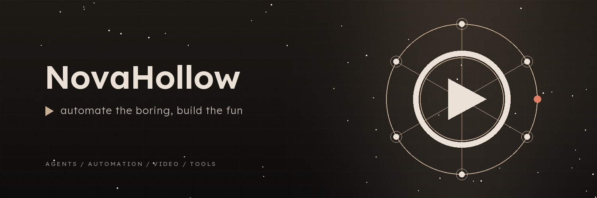

  

### Automate the boring. Build the fun.

I build AI agents, automated video pipelines, and small tools that remove the parts nobody wants to do.
If it happens twice, it becomes a script.

---

**Currently**

- Teaching agents to use real tools instead of talking about them
- Running NextPhase's free AI editor natively on Windows, no WSL
- Taking "what if this was a script?" too literally

**Latest experiment**

[**editor-v1-windows**](https://github.com/NovaHollow/editor-v1-windows) — a talking-head recording in, a fast documentary-style cut out. Free, local, and finally working on Windows.

**Things I make**

| | |
| --- | --- |
| **Agents** | tool-using assistants, local or API, wired into real workflows |
| **Video** | auto-cuts, silence removal, captions, batch renders |
| **Tools** | small utilities that do one thing well and look good doing it |
| **Glue** | scripts that connect the APIs you already pay for |

**The playground**

`ffmpeg` · `Python` · `TypeScript` · local models · too many APIs · one good idea at a time

> The best automation is the one you forget is running.

Also built: Nova Calc

A quiet calculator with a hidden encrypted ledger. <a href="https://github.com/NovaHollow/nova-calc">Source</a> · <a href="https://github.com/NovaHollow/nova-calc/releases/latest">Download</a>

Open to weird ideas and useful problems.

