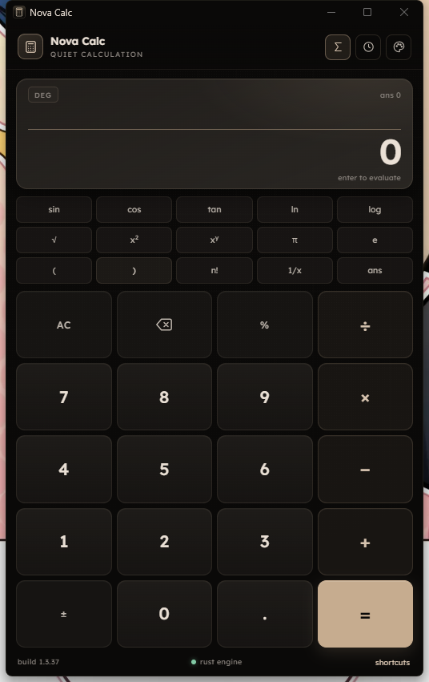
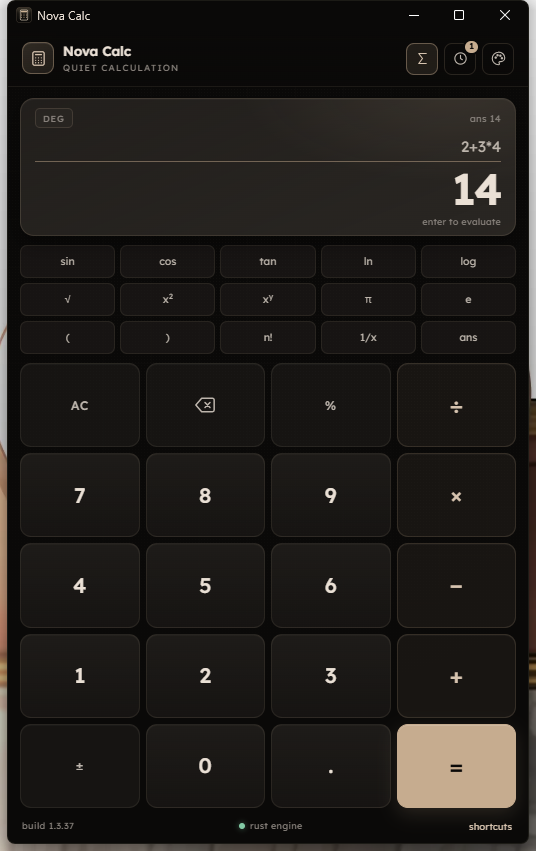

  

### Hey, I'm NovaHollow

I build small desktop tools that open fast, stay quiet, and look good at 2 a.m.
Local-first by default — no accounts, no telemetry, nothing phoning home.

---

<table>
<tr>
<td width="54%" valign="top">

**Nova Calc** — a quiet calculation terminal for Windows.

- Rust tokenizer and parser, no `eval`
- 18 themes derived from one accent
- Encrypted off-book ledger, AES-256-GCM + Argon2id
- A single 1.1 MB `.exe`, no installer

[Repository](https://github.com/NovaHollow/nova-calc) · [Download](https://github.com/NovaHollow/nova-calc/releases/latest)

</td>
<td width="46%" valign="top">
  
</td>
</tr>
</table>

### Toolbox

  
  
  
  

### What I'm up to

- Building **Nova Calc** and the interface language behind it — warm surfaces, one accent, dense but calm.
- Getting better at Rust, one small binary at a time.
- Open to ideas for tools that should be simpler than they are.

More of Nova Calc

  

Hearth palette · build 1.3.37

